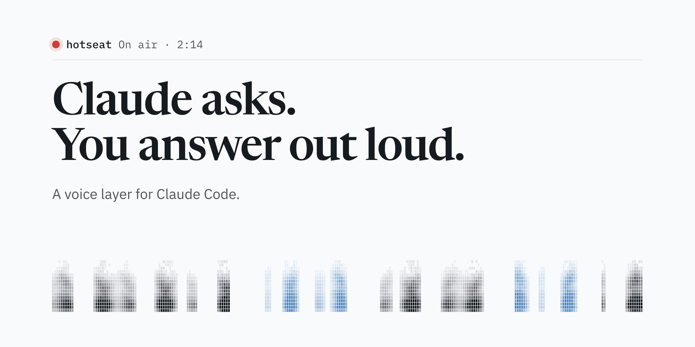
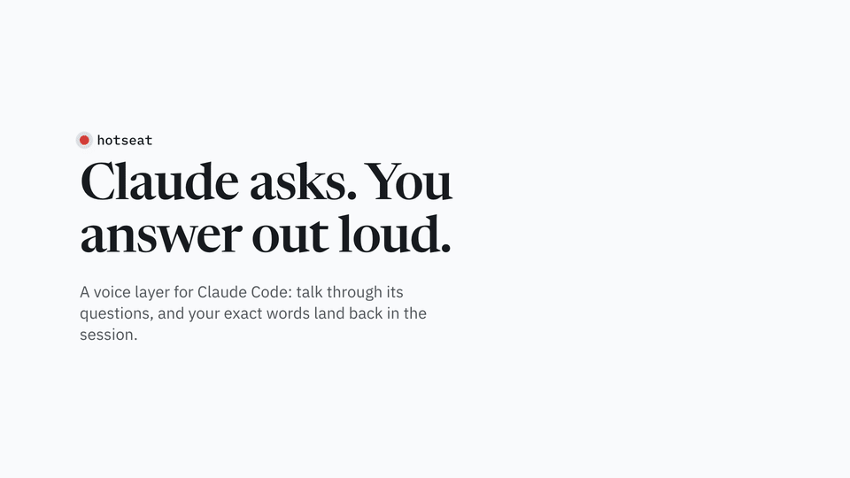
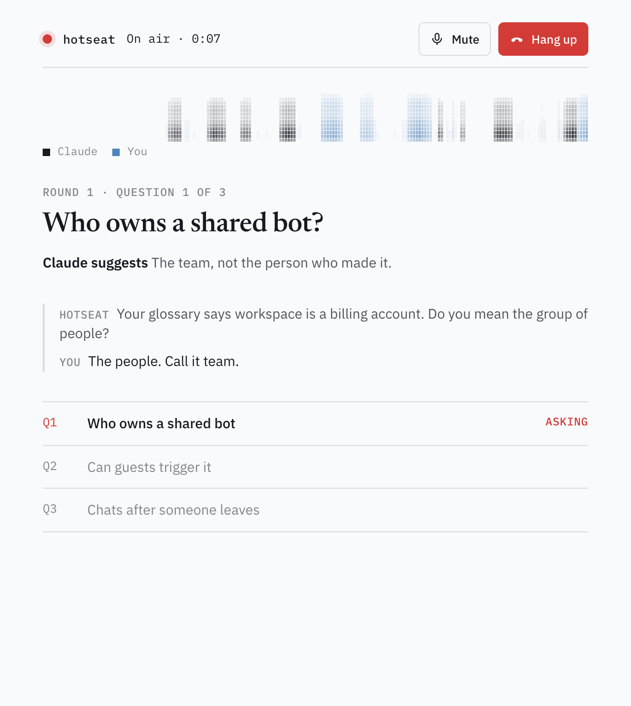
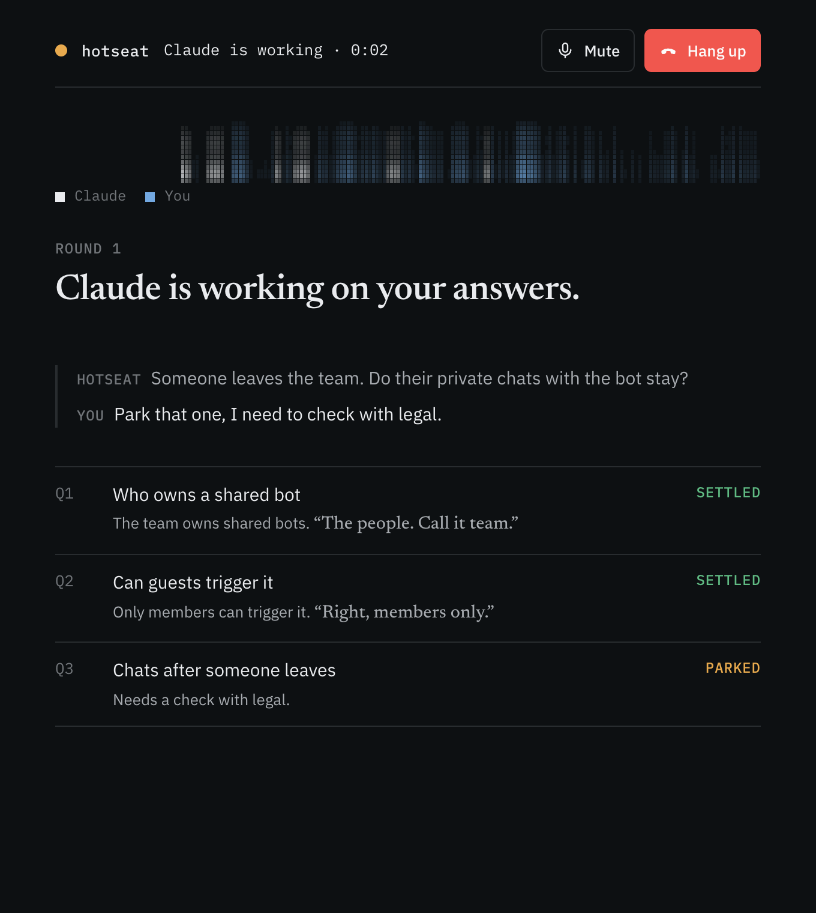

<p align="center">
  
</p>

<h1 align="center">hotseat</h1>

<p align="center">A voice layer for Claude Code. When Claude has questions for you, answer them out loud on a call, and your exact words land back in the session.</p>

## See it

<p align="center">
  <a href="docs/img/demo.mp4"></a>
</p>
<p align="center"><sub>31 seconds, no sound. <a href="docs/img/demo.mp4">MP4 version</a>.</sub></p>

## How it works

1. **Claude asks a round of questions.** Grilling a plan, confirming a spec, anything with a recommendation per question. Hotseat adds one line at the end: `v · answer out loud`.
2. **Reply `v`.** A call window opens next to your terminal. Press **Pick up**.
3. **Talk it through.** A voice agent asks each question with Claude's recommendation, so "yes" accepts it. Say "you decide", "park it" or "go back" whenever you need to. Interrupt it like you would a person.
4. **Check, then send.** After the last question the window shows just your answers. Say "send it" or tap **Confirm**, or tap an answer to change it. Quiet for 20 seconds sends it as is.
5. **Your answers land in Claude Code** with the words you actually said, so nothing gets paraphrased away. Claude keeps going: glossary, ADRs, the next question.
6. **The next round goes straight into the same call.** No second `v`. Claude hangs up when nothing is left to ask.

Claude stays the brain: it picks the questions, reads the repo and writes the files. The voice agent is only ears and mouth.

## The call window

<p>
  
  
</p>

- **On air.** A red light and a call timer while you talk, amber while Claude works on your answers.
- **Spectrogram.** Sixteen bands drawn from the call's real audio, ink for Claude and blue for you, so you can see who's talking and when.
- **The question in full,** with Claude's suggested answer under it and the last thing each side said.
- **A ledger of the round.** Settled answers keep your quote, parked ones keep the reason.

Built for Matt Pocock's [grilling and grill-with-docs skills](https://github.com/mattpocock/skills) (MIT), and it works for any round of questions.

## Install

In Claude Code:

```
/plugin marketplace add jcodebreaker/hotseat
/plugin install hotseat@hotseat
```

Paste your [ElevenLabs API key](https://elevenlabs.io/app/settings/api-keys) when asked (it's stored in your system keychain), then run `/reload-plugins`. On the first call hotseat creates its voice agent in your ElevenLabs account. Needs Node 22.9 or later.

Try it: `/grill-with-docs <your idea>`, then reply `v`.

Claude Code moves a tool call that runs longer than 2 minutes to a background task. That's expected: Claude waits, and the answers arrive when the round is done.

## Under the hood

```
Claude Code ──stdio MCP──▶ mcp/server.mjs   ask_by_voice(round), end_call()
                              │ HTTP on 127.0.0.1, random port
                              ▼
                         public/call.html ──WebRTC──▶ ElevenLabs agent (prompt.md)
                              ▲                            │
                              └── settle_answer / park_question (client tools)
```

- **`skills/hotseat`** tells Claude when to offer voice and how to use the answers. **`hooks/v.mjs`** catches a bare `v` reply, so it works even when Claude forgets.
- **`hooks/stop.mjs`** won't let Claude end its turn while you're on the call waiting: it has to send the next round or hang up. No silent calls.
- **`mcp/agent.mjs`** creates the voice agent and its two tools on the first call, and updates them whenever `prompt.md` changes.
- **The call window** is plain HTML with no build step: OKLCH tokens, Newsreader and IBM Plex, light and dark.

## Privacy

- The local server listens on `127.0.0.1` only. Your API key stays in the server process and never reaches the browser, which gets a short-lived conversation token instead.
- Call audio and the round's questions go to ElevenLabs, which runs the voice agent. The call window loads the ElevenLabs SDK from jsDelivr and its fonts from Google Fonts. hotseat has no server of its own.

## Develop

```sh
git clone https://github.com/jcodebreaker/hotseat && cd hotseat
npm install
cp .env.example .env            # ELEVENLABS_API_KEY=...
claude --plugin-dir .
npm run check                   # offline check of the MCP round lifecycle
```

## Roadmap

- [ ] Mid-call lookups: "Claude's checking…" while a sub-agent reads the repo, without leaving the call
- [ ] A menu-bar call window instead of a browser tab
- [ ] More voice providers behind the same contract (OpenAI Realtime first)
- [ ] Grill a diff or a PR, not only an idea

MIT.
